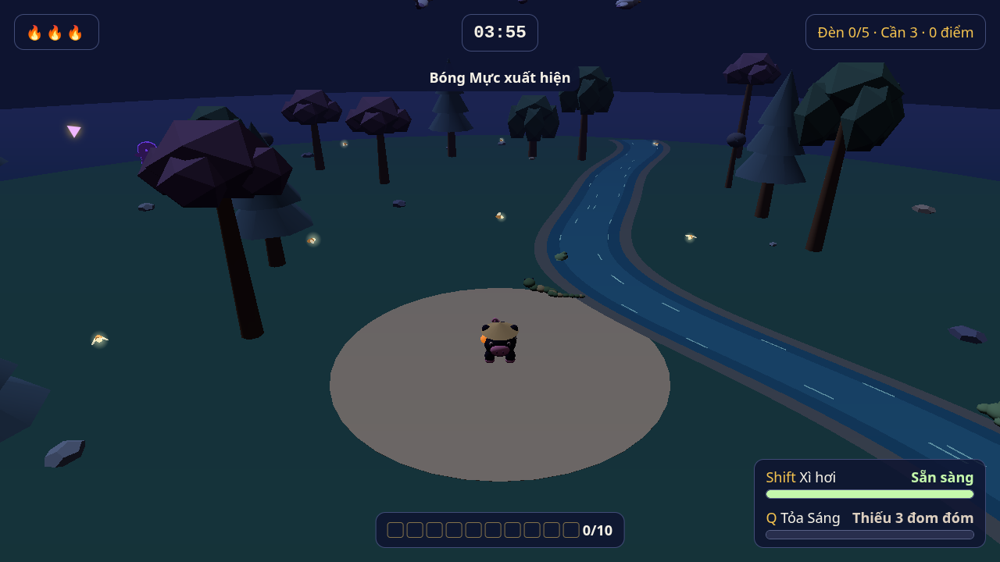

# Day 12 — AI SDLC: Đảo Đèn Lồng

[Video demo MP4](https://github.com/Phan-Trong-Hau/K5-L3A-DAY12-PhanTrongHau-2A202603547-AI-SDLC-Dao-Den-Long/releases/download/v1.0.1/demo.mp4) · [Bản phát hành v1.0.1](https://github.com/Phan-Trong-Hau/K5-L3A-DAY12-PhanTrongHau-2A202603547-AI-SDLC-Dao-Den-Long/releases/tag/v1.0.1)

> **Cá nhân** (1 người / 1 MSSV) · Áp dụng SDLC cùng AI để xây một **game 3D** qua **4 phase**, từ yêu cầu ban đầu tới bản phát hành.
> **Lab board + trợ giảng:** **[Đảo Đèn Lồng Lab](https://claude.ai/artifact/Q1RYyv1dxjUczzCbd2ZnoW)**

---

## Chạy bản web

Game 3D trên trình duyệt. Cần macOS hoặc Linux, Node.js 22.14.0 trở lên và trình duyệt hỗ trợ WebGL 2. Phép đo benchmark cần Chrome hoặc Chromium. Từ thư mục gốc repo, dùng hai lệnh sau.

```bash
npm ci
npm run dev
```

Mở địa chỉ Vite in trong terminal. Bấm **Bắt đầu** để chơi lần lượt Đảo Bến, Đảo Cau và Đảo Chuông hoặc **Chọn màn** để vào thẳng màn 1, 2 hoặc 3. Trong Chọn màn, bấm **F** gần rắn hoặc ếch để bắt, rồi bấm lại để ném về phía Bóng Mực. Nếu F đã được gán, HUD hiện phím còn trống. Lượt này không lưu bảng xếp hạng. Nhặt đom đóm, thắp đèn và giữ đủ đèn sáng tới bình minh. Cần 3/5 đèn ở Đảo Bến, 4/6 ở Đảo Cau và 5/7 ở Đảo Chuông.

- **WASD / phím mũi tên hoặc chuột phải** để đi, **Space** để nhảy và **Shift** để lướt và xì hơi. Hai thanh ở góc dưới bên phải đầy dần trong lúc hồi chiêu và chuyển xanh khi sẵn sàng. Tỏa Sáng báo thiếu đom đóm nếu cần.
- **E** để nạp đèn tắt hoặc châm dầu cho đèn đang sáng. **Q hoặc nhấp chuột trái** để tỏa sáng, tốn ba đom đóm. **Kéo chuột trái** để xoay camera, cuộn chuột để zoom.
- **Esc/P** để tạm dừng. Menu có Cài đặt, Chơi lại Đêm và Về menu. Bật **Bảng màu dễ phân biệt** trong Cài đặt để đổi viền và mắt Bóng Mực sang xanh dương, cảnh báo sang trắng kèm biểu tượng ⚠.
- Nạp mỗi đom đóm được 5 điểm. Thắp lần đầu được 100 điểm, thắp lại được 40 điểm. Làm choáng Bóng Mực được 5 điểm, hoặc 15 điểm nếu nó đang hút dầu. Khi thắng, mỗi đèn còn sáng cộng 50 điểm cộng phần nguyên của dầu còn lại, mỗi lửa còn lại cộng 50 điểm.



### Headless v1.3

[game.contract.json](game.contract.json) công bố lệnh và tuning cho ba đêm. Để chạy kiểm tra và tạo JSONL:

```bash
npm test
node src/headless.js --seed 7 --night 3 --ticks 18000 --out /tmp/dao-den-long.jsonl
```

Nhận `--night 1|2|3`, `--scenario <file.json>`, `--inputs <file.json>` và `--snapshot-every <int>`. Xem [bằng chứng Phase 4 làm lại](docs/proof/phase-4/rerun.md), [retro](docs/notes/retro.md) và [changelog](CHANGELOG.md).

### Benchmark và soak

```bash
node scripts/bench.js --seed 42 --duration 30 --out bench.json
node --jitless --expose-gc scripts/soak.js --seed 7 --nights 10 --out soak.json
```

Benchmark mở Chrome 1280×720, tắt VSync qua cờ Chromium và chạy 3 giây khởi động. Nếu trình duyệt không nằm trên PATH, đặt `CHROME_BIN` trỏ tới executable. Máy không có màn hình dùng Chromium headless với cùng kích thước canvas. `peak_mem_mb` là `null` vì bản web chạy qua nhiều tiến trình Chromium và không có RSS tiến trình game độc lập. Soak chạy 10 lượt trong cùng một tiến trình Node.js, dùng `--jitless` để tránh tăng bộ nhớ mã biên dịch JIT giữa hai mốc đo RSS. `npm run verify` chạy test, build và chặn khi soak vượt 20% hoặc có crash. GitHub Actions dùng cùng lệnh.

### Bảng xếp hạng và trợ năng

Nhập tên sau khi thua hoặc tới màn Bình Minh. Bảng điểm lưu top 10 trên đĩa khi chạy bằng Node và trong dữ liệu trình duyệt khi dùng bản web tĩnh. Tên dài 3–12 ký tự, dùng chữ Latin không dấu, số và dấu gạch dưới.

```bash
node scripts/run.js --export-leaderboard out.json
```

Cấu hình `DAO_LEADERBOARD_FILE` để dùng file lưu riêng. Trong Cài đặt có đổi phím, khôi phục phím mặc định, bảng màu dễ phân biệt, giảm chuyển động và chữ lớn. Chuột phải để đi, chuột trái để Tỏa Sáng vẫn có sẵn.

### Sáng tạo của tôi

Mây là chú heo thân đen, mõm, móng và đuôi hồng, đội nón lá và mang đèn lồng nhỏ. Mỗi lần lướt thành công, Mây xì hơi và để lại một cụm khói hoạt hình. Khi Tỏa Sáng, Mây nhấc hai chân trước rồi dậm xuống. Hai dấu móng hồng lóe lên, đất lún rộng và nứt ra trước khi phẳng lại. Đom đóm có cánh vỗ, bụng sáng và quầng sáng nhấp nháy. Cả ba đêm có rừng, suối, đá, chim, rắn và ếch. Hai bờ Đảo Cau còn có rùa. Mây, rắn, ếch và rùa chìm dần đến ngang thân khi lội qua suối. Bản web và headless cùng dùng bản đồ chuẩn và cùng logic gameplay. Kết quả chạy lặp JSONL ở bằng chứng Phase 3.

## Tài liệu của lab

| File | Nội dung |
|---|---|
| [GUIDE.md](GUIDE.md) | Hướng dẫn làm lab: vòng làm việc mỗi phase, harness, kiểm chứng, token |
| [CHECKPOINTS.md](CHECKPOINTS.md) | Các mốc tự kiểm tra từ chuẩn bị đến nộp bài |
| [SUBMISSION.md](SUBMISSION.md) | Đặt tên repo, hạn nộp, tag, Release, video, checklist |
| [RULES.md](RULES.md) | Quy định: AI, trung thực về bằng chứng, bản quyền, bảo mật |
| [RUBRIC.md](RUBRIC.md) | Thang điểm chi tiết |

## Lab board

Yêu cầu dự án được phát hành tại **[Đảo Đèn Lồng Lab](https://claude.ai/artifact/Q1RYyv1dxjUczzCbd2ZnoW)**. Mỗi phase là một tab (tab chưa phát hành bị khóa), mỗi tab có trợ giảng AI riêng chỉ trả lời trong phạm vi phase đó. Trợ giảng cần đăng nhập claude.ai và dùng lượt Claude của bạn.

## Dự án

**Đảo Đèn Lồng**: game 3D góc nhìn thứ ba. Mây, người giữ đèn nhỏ tuổi, gom đom đóm để thắp và châm dầu cho các Đèn Lồng Lớn, đồng thời né Bóng Mực trong sương đen.

- Không ràng buộc công nghệ; chạy được trên macOS hoặc Linux.
- Tuân theo **Test Contract** (chế độ headless) để được chấm tự động và so sánh với nhau.

| Phase | Bạn nhận | Nộp |
|---|---|---|
| 1 | **PRD-0** (mô tả tổng quát) + Test Contract | tag `phase-1` |
| 2 | **Ticket-02**, phát hành khi Phase 1 kết thúc | tag `phase-2` |
| 3 | **Ticket-03**, phát hành khi Phase 2 kết thúc | tag `phase-3` |
| 4 | **Ticket-04**, phát hành khi Phase 3 kết thúc | tag `phase-4` + Release `v1.0.0` |

Yêu cầu sẽ được bổ sung và có thể thay đổi giữa các phase, giống dự án thật.

### Lịch 4 giờ

Bài lab kéo dài **4 giờ**. Phase 1 và 2 khoảng **1 giờ**, Phase 3 khoảng **30 phút**, Phase 4 khoảng **1 giờ 30 phút**. Mỗi phase phát hành đúng mốc giờ. Phase mới xuất hiện trên lab board khi tới mốc.

| Mốc | Sự kiện | Hạn tag |
|---|---|---|
| 0h | Phát hành **Phase 1** (PRD-0), gồm cả phần chuẩn bị | `phase-1` trước mốc 1h |
| 1h | Phát hành **Phase 2** | `phase-2` trước mốc 2h |
| 2h | Phát hành **Phase 3** | `phase-3` trước mốc 2h30 |
| 2h30 | Phát hành **Phase 4** | `phase-4`, Release `v1.0.0` và video trước mốc 4h |
| 4h | Hết giờ lab, chốt bài | |

Hết giờ mỗi phase thì tag và chuyển sang phase tiếp theo, dù phase chưa hoàn hảo. Chỗ chưa xong ghi trung thực trong bằng chứng.

---

## Gợi ý SDLC (cách làm là của bạn)

Mỗi phase là một vòng nhỏ. Công cụ, thứ tự, định dạng tài liệu đều tự do; đây chỉ là gợi ý:

1. **Requirements:** biến yêu cầu thành tiêu chí nghiệm thu kiểm chứng được. Chỗ mơ hồ thì tự giả định và ghi lại.
2. **Plan:** nghĩ cách kiểm chứng **trước** khi để agent viết code.
3. **Build:** để agent viết, bạn điều phối và review.
4. **Verify:** chạy thật, kiểm tra hành vi thật. *Không có bằng chứng thì chưa xong*: "agent bảo chạy rồi" không phải bằng chứng.
5. **Evaluate:** cái gì đạt, AI sai ở đâu, harness (AGENTS.md, skill, hook) cần chỉnh gì.
6. **Release:** gắn tag.

## Ba điều cần nhớ

> Bạn được **tự do sáng tạo thêm** quanh phần lõi (nhân vật, cơ chế nhỏ, câu chuyện, hiệu ứng, âm thanh…). Sáng tạo gọn và không phá yêu cầu được tính điểm trong hạng mục F của [RUBRIC](RUBRIC.md); ghi mục "Sáng tạo của tôi" trong README của bạn.

- **Game tốt là game đúng yêu cầu của khách hàng**, không phải game phức tạp hay đẹp nhất. Làm đúng và chứng minh được là đúng trước, trau chuốt sau.
- **Cân nhắc kỹ quota token của bạn.** Đốt nhiều token không làm bài tốt hơn. Ngữ cảnh gọn, kế hoạch rõ, kiểm chứng sớm thường vừa rẻ vừa đúng hơn chạy agent liên tục.
- **Kiểm chứng là phần quan trọng nhất.** Bằng chứng (test, output headless, ảnh, số đo) đáng giá hơn lời mô tả.

---

## Bàn giao cuối cùng

Một **repo GitHub cá nhân, public**, gồm:

1. **Toàn bộ mã nguồn** của game qua 4 phase, tag `phase-1` … `phase-4`, Release `v1.0.0`.
2. **Video demo `.mp4` dưới 5 phút** (đính kèm Release `v1.0.0` hoặc `docs/demo/demo.mp4`, link ở đầu README): chơi thử và cho thấy bằng chứng game chạy đúng.
3. **Bằng chứng kiểm chứng** của từng phase (định dạng tự chọn).
4. **Harness AI đã dùng** (AGENTS.md / CLAUDE.md, skills, hooks, plugins…), giữ nguyên trong repo và lịch sử git.
5. **Ghi chép ngắn:** spec/giả định mỗi phase, nhật ký dùng AI (gồm token/chi phí ước tính), retro.

Không commit API key, token hay `.env`. Gửi link repo theo hướng dẫn của Coach.

## Đánh giá (100 điểm)

| Hạng mục | Điểm |
|---|---|
| Test tự động ẩn (headless, gồm kiểm tra lại phase trước) | 30 |
| Kiểm chứng & bằng chứng của bạn | 20 |
| Quy trình SDLC & harness AI | 15 |
| Evaluation & retro (gồm cách bạn dùng token) | 10 |
| Hiệu năng & ổn định | 10 |
| Chất lượng sản phẩm (đúng yêu cầu, chơi được) | 10 |
| Video demo | 5 |

## Quy định

- Dùng AI thoải mái; không sao chép repo của người khác.
- Bằng chứng phải thật: test luôn đạt hay output sửa tay là vi phạm.
- Nhân vật, bối cảnh là bản gốc của lab; asset bên ngoài chỉ dùng loại CC0/CC-BY/MIT hoặc tự tạo, ghi nguồn trong `CREDITS.md`.
